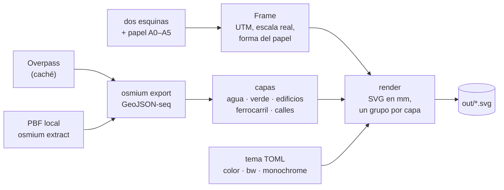

<h1 align="center">vector-maps</h1>

<p align="center">
  Mapas de OpenStreetMap en SVG, por capas y con nombres, en color o en blanco y
  negro y listos para imprimir en A0–A5. Con la opción de superponer dos zonas con
  distinto zoom en la misma hoja.
</p>

<p align="center">
  
  
  <a href="LICENSE.GPL-3.0.txt"></a>
  <a href="LICENSE.CC-BY-SA-4.0.txt"></a>
</p>

## TL;DR

En Linux, con Docker y `make` (nada más: ni Python ni librerías en el host):

```bash
# Un mapa A4 en blanco y negro del casco histórico de Santiago de Compostela
make map TL=42.8845,-8.5510 BR=42.8775,-8.5385 THEME=bw OUT=out/santiago.svg PDF=1
```

`TL` es la esquina de arriba a la izquierda y `BR` la de abajo a la derecha,
ambas `LAT,LON`. Quedan en `./out/` el SVG y, por `PDF=1`, un PDF del tamaño
del papel (`santiago.pdf`), los dos con tu usuario (no de root). Sin `PDF=1`,
solo el SVG. `THEME=monochrome TINT=#7a2e1f` lo deja en tonos de un solo color,
`INCLUDE_LAYERS=street-names,places` le añade los nombres e
`INCLUDE_LAYERS=hillshade,contours` el relieve (ninguno de los dos sale por defecto).

El servidor público de Overpass se cae con frecuencia. Para no depender de él,
baja un extracto una vez y úsalo siempre:

```bash
make pbf URL=https://download.geofabrik.de/europe/spain/galicia-latest.osm.pbf
make map TL=42.8845,-8.5510 BR=42.8775,-8.5385 PBF=data/pbf/galicia-latest.osm.pbf PDF=1
```

No hace falta ninguna cuenta ni clave.

## Cómo funciona



1. **El área.** Dos esquinas y un papel. La zona se amplía (nunca se recorta)
   hasta tener la forma exacta del papel, y la escala sale en metros reales
   (1:N). ADR 0003.
2. **Los datos.** De Overpass (con caché) o de un PBF local; `osmium`
   ensambla las geometrías. ADR 0002.
3. **El SVG.** Unidades en mm, un grupo de Inkscape por capa, y el estilo de un
   tema TOML. Con los nombres de calles y lugares si se añaden con `INCLUDE_LAYERS` (en
   castellano por defecto, `LABEL_LANG=gl` para otro idioma; ADR 0006) y una leyenda con las esquinas del
   mapa y la atribución de OSM. ADR 0004.

## Superponer dos zonas

Una zona base y otra encima, **en la misma hoja y con otro zoom** (la forma del
papel es la común). Cada una lleva su tema, sus capas y su opacidad:

```bash
# Vista amplia en color, y encima el detalle en blanco y negro al 70 %
make map PBF=data/pbf/galicia-latest.osm.pbf \
  TL=42.8845,-8.5510  BR=42.8775,-8.5385 THEME=color \
  TL2=42.8830,-8.5470 BR2=42.8815,-8.5440 THEME2=bw OPACITY2=0.7 \
  OUT=out/superpuesto.svg
```

En Inkscape, cada zona (`area-a`, `area-b`) y cada capa son capas aparte: se
ocultan, se mueven o se borran sin regenerar nada. ADR 0005.

## Documentación

- [`docs/uso.md`](docs/uso.md): todas las opciones, las capas, los temas y
  cómo imprimir.
- [`docs/decisions/`](docs/decisions/): por qué es como es.
- [`docs/desarrollo.md`](docs/desarrollo.md): lo que queda por hacer.
- [`CHANGELOG.md`](CHANGELOG.md) y [`AGENTS.md`](AGENTS.md) (directrices para
  quien contribuya, persona o agente de IA).

## Desarrollo

```bash
make check   # ruff + pytest, dentro de Docker
```

## Licencias

Este trabajo está bajo la licencia [GPL-3.0](LICENSE.GPL-3.0.txt) (o superior)
en lo que respecta al software y bajo la
[Creative Commons BY-SA-4.0](LICENSE.CC-BY-SA-4.0.txt) con respecto al resto de
contenido (la documentación).

**Los datos de los mapas** son de OpenStreetMap, © los colaboradores de
OpenStreetMap, bajo la [ODbL](https://www.openstreetmap.org/copyright). Un mapa
generado con ellos es una obra producida: puede llevar la licencia que quieras,
pero **debe atribuir a OpenStreetMap**, y por eso cada SVG lo hace en su pie y
no hay opción para quitarlo.

Dependencias de terceros:

| Qué | Dónde | Licencia | Para qué |
|---|---|---|---|
| [Shapely](https://github.com/shapely/shapely) 2.2.0 | Paquete de Python, dentro de la imagen | BSD-3-Clause | La geometría: recortar, validar, trabajar con polígonos |
| [pyproj](https://github.com/pyproj4/pyproj) 3.8.0 | Paquete de Python, dentro de la imagen | MIT | Proyectar de WGS84 a UTM |
| [NumPy](https://numpy.org) 2.5.4 | Paquete de Python, dentro de la imagen | BSD-3-Clause | Dependencia de Shapely; el proyectado por lotes |
| [osmium-tool](https://github.com/osmcode/osmium-tool) | Programa en la imagen, invocado como proceso aparte | GPL-3.0+ | Cortar extractos y exportar a GeoJSON |
| [pytest](https://pytest.org), [Ruff](https://github.com/astral-sh/ruff) | Solo desarrollo, dentro de la imagen | MIT | Tests y lint |
| [python:3.12-slim](https://hub.docker.com/_/python) | La base de la imagen Docker: no está en el repo | PSF y la de cada paquete de Debian | La imagen |

Son compatibles con la GPL-3.0. Quien distribuya la imagen tiene que
acompañarla de los avisos de licencia de esas dependencias; hoy no van dentro
de ella.
